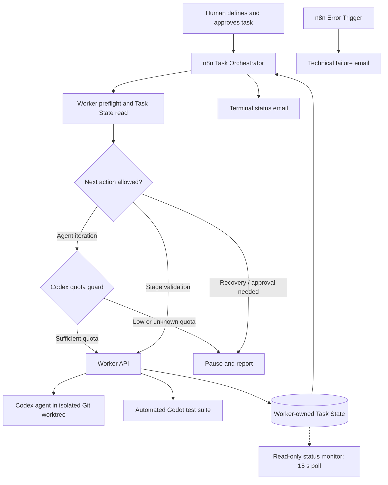

# Guardrailed AI Agent Orchestration with n8n

**AI automation · Agent orchestration · API integration · Reliability engineering**

A practical case study of an **n8n-based control plane for AI-assisted software development**. The system coordinates a coding agent (OpenAI Codex) through a separate local Worker service, using explicit task state, bounded iterations, quota checks, automated test gates, read-only monitoring, and human approval.

It was developed for **[Deckdrive](https://github.com/Wojtek0110/deckdrive)**, a Godot-based card-driven game. This repository showcases the **automation architecture** separately from the game source code.

> **Portfolio case study, not a one-click deployment.** The JSON files in [`workflows/`](workflows/) are **sanitized, inactive, and intentionally non-operational**. Write actions and the local command runner are neutralized. They are suitable for inspecting the design in n8n, not for running against a production Worker.

## The problem

A coding agent can generate changes, but a longer implementation task needs more than one prompt. I wanted a repeatable process that could:

- Split an approved goal into **TASK → STAGE → ITERATION** and decide the next valid action from persisted state.
- Invoke the agent only within a verified Git worktree/branch and approved scope.
- Validate each stage with automated tests, while preserving **human-controlled approval and Git integration**.
- **Stop safely** on failed validation, interrupted runs, low/unknown quota, or ambiguous state.
- Make ongoing progress and failure reasons observable without manually checking every execution.

## System architecture



**Separation of responsibilities:** n8n orchestrates; the **Worker owns Task State, iteration checkpoints, and stage validation**; Codex implements only authorized changes; the human owns final review, commits, merges, and execution approval. The monitor never changes task state.

## Three n8n workflows

| Workflow | Purpose | Selected design details |
| --- | --- | --- |
| [Task Orchestrator + Quota Guard](workflows/01-orchestrator.public-demo.json) | Drives an authorized multi-stage task based on current Worker state | Preflight checks, stage/iteration decisions, dry-run verification, quota thresholds, blocking Worker calls, explicit stop conditions |
| [Live Task Monitor](workflows/02-live-monitor.public-demo.json) | Observes progress without modifying execution | HTTP status polling every **15 seconds**, progress labels, terminal-state detection, six-hour time limit |
| [Error Alert via SMTP](workflows/03-error-alert.public-demo.json) | Reports technical n8n failures | Error Trigger, minimal diagnostic email, no raw execution payload in the alert |

The orchestrator also has a **terminal-status email branch** for cases such as `HUMAN_REQUIRED`, `RECOVERY_REQUIRED`, `READY_FOR_REVIEW`, `FAILED`, and quota pauses. These are notifications, **not approvals**.

## Notable engineering decisions

| Concern | Approach |
| --- | --- |
| **Agent autonomy** | Work is scoped to a human-approved task and one Worker-authorized iteration at a time. |
| **Controlled code changes** | Worker enforces the approved file scope and a maximum of **four distinct repository files per iteration**. |
| **State consistency** | Workflow reads persisted Task State; interrupted or inconsistent runs stop for inspection instead of blindly retrying. |
| **Quota awareness** | Before a real Codex iteration, a separate local probe feeds a fail-closed guard: pause at **≤10% 5-hour quota** or **≤5% weekly quota**, or when quota data is invalid. |
| **Verification** | Focused tests accompany iterations; the Worker runs the full Godot test suite at a stage checkpoint. |
| **Safe preview** | Preview is only considered successful after the Worker confirms no agent invocation, no tests, and no state write. |
| **Human-in-the-loop** | Manual gates, final `COMPLETE`, and Git integration remain separate human decisions. |
| **Observability** | Read-only polling, meaningful status labels, terminal emails, and error notifications. |

## Example project scope and evidence

The historical use case represented by the exports was the **Deckdrive starter-card system** (`DD-GAME-13-003`), organized into **10 stages**, from typed CSV card data and card identity through reusable effects, legal movement, and a gameplay-to-HUD boundary.

Project handoff documents dated **20–24 October 2026** record the task as `COMPLETE` after human review and report that the integrated game passed its full test runner plus manual single-player and two-player checks (integrated in **[Deckdrive PR #31](https://github.com/Wojtek0110/deckdrive/pull/31)**). These are **historical project records**, not tests re-executed by this portfolio repository. See [case study](docs/case-study.md) for what was delivered, what was measured, and what remains out of scope.

## Where Data & AI skills appear

This is an **applied AI / automation engineering** project, not a machine-learning training project or an ETL pipeline. The relevant transferable skills are:

- **AI agent systems:** constrain automated code-generation with explicit permissions, state transitions, and review gates.
- **Structured data handling:** validate HTTP/JSON responses, interpret task lifecycle fields and quota measurements, and reject malformed inputs.
- **Integration engineering:** orchestrate n8n, a custom HTTP Worker, a local Node.js quota probe, Git worktrees, automated tests, and SMTP.
- **Production-minded operations:** design fail-closed paths, recoverable checkpoints, and operational visibility instead of treating a successful API call as proof of success.

**Tech stack:** `n8n` · `JavaScript` (Code nodes) · `REST/HTTP` · `JSON` · `Node.js` quota probe (external dependency) · `OpenAI Codex` · `Git`/worktrees · `Godot` test automation · `SMTP`

## Explore the repository

```text
.
├── README.md
├── workflows/
│   ├── 01-orchestrator.public-demo.json
│   ├── 02-live-monitor.public-demo.json
│   └── 03-error-alert.public-demo.json
├── docs/
│   ├── architecture.md
│   ├── case-study.md
│   ├── security-and-limitations.md
│   └── publishing-guide-pl.md
└── assets/
    └── README.md
```

Start with [architecture and workflow responsibilities](docs/architecture.md), then inspect the exported n8n graph files. To view them visually, import an export into an **isolated n8n instance** and inspect the canvas **without executing or activating** it.

### Can I run this locally?

**Not from this repository alone.** The operational system depends on a separate custom Worker API, its Task State and checkpoint storage, a configured Codex execution environment, a quota-probe script, a compatible Git worktree, a Godot test runner, and credentials for authenticated HTTP and SMTP. These components and credentials are not published here. The public exports are intentionally deactivated and safety-modified.

For deployment boundaries, redactions, and known limitations, read [security and limitations](docs/security-and-limitations.md).

## My role

I designed and assembled the n8n workflows, task/stage orchestration rules, monitoring and alerting flow, and safeguards around the Codex–Worker integration as part of the Deckdrive development process. The **Worker and the coding agent are distinct components**, and the game implementation must not be described as code produced by n8n itself.

## Next improvements

Potential follow-ups include publishing a **mock Worker API** and synthetic test fixtures for repeatable demos, running automated contract tests for state transitions, and adding a small metrics dashboard for iteration duration and failure categories. **These are future improvements, not features claimed as implemented.**
