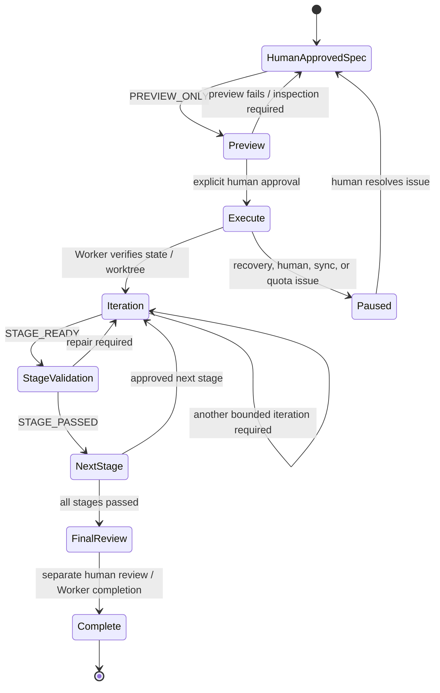

# Architecture and control boundaries

This document explains the division of responsibilities in the historical Deckdrive automation. It is intentionally more technical than the root README.

## Components

| Component | Authority / responsibility |
| --- | --- |
| Human (game director / reviewer) | Approves gameplay decisions, TASK/STAGE specifications, execution, manual gates, final COMPLETE, and Git integration. |
| n8n orchestrator | Selects the next requested Worker operation based on the approved spec and current Worker state; checks quota before a real Codex iteration; sends terminal notifications. |
| Custom Worker service | Owns Task State, checkpoints, allowed-file enforcement, agent execution, test execution, and validation of state transitions. |
| Codex coding agent | Executes only the authorized iteration in the separate agent worktree. Does not perform Git integration. |
| Read-only monitor | Observes Worker Task State every 15 seconds; does not initiate or modify tasks. |
| SMTP / error handler | Reports terminal statuses and n8n technical failures without granting approval. |

## Main task lifecycle



Diagram is a conceptual lifecycle summary, not an exhaustive list of Worker status fields.

## Decision logic

1. **Preflight:** confirm Worker API readiness, agent support, test runner, approved worktree/branch/HEAD and expected task identity.
2. **Read authoritative status:** use `/task/status/{task_id}` rather than infer progress from a previous n8n execution.
3. **Select next action:** choose only the approved first/next iteration or stage validation; stop on incompatible, interrupted, or unverified states.
4. **Quota guard:** if this is a real Codex iteration, obtain structured quota percentages from an external local Node.js probe. If either threshold is low or the probe is invalid, **pause without launching Codex**.
5. **Worker HTTP request:** historically invokes the Worker's guarded task endpoint for an authorized iteration or stage validation. In the **public export this write-action node has been replaced by a No Operation node**.
6. **Verify response:** for preview, require a Worker dry-run status plus explicit no-write/no-tests/no-agent evidence. For execution, process the verified state and continue or stop.
7. **Notify:** provide a final result and send an email for statuses requiring attention; email delivery does not change Task State.

## Quota guard example

The historical n8n Code node checks these fields in an external probe response:

```json
{
  "status": "CODEX_QUOTA_READ_OK",
  "five_hour": { "remaining_percent": 35 },
  "weekly": { "remaining_percent": 60 }
}
```

**This is an illustrative input shape, not a captured production reading.** It allows a decision at the workflow boundary without storing API tokens or relying on ambiguous text output. The guard rejects missing, invalid, or out-of-range percentages. The external probe implementation is not part of this repository.

## Monitoring

The second n8n workflow uses a manual trigger, an authenticated (in production) read-only HTTP status call, a status-normalization Code node, a conditional loop, and a 15-second Wait node. It stops at a terminal condition or after a six-hour monitoring limit. It handles a task not yet created by stopping safely rather than creating Task State.

## Errors and communication

The third workflow uses **n8n Error Trigger** to format technical failure context and send it through SMTP. It is designed for automatic production executions; manual n8n workflow runs do **not** trigger this error workflow in the same way. The orchestrator separately prepares business/status emails after controlled checkpoints.

## Critical distinction

The n8n workflows **do not prove that generated code is correct**. The verification chain is: agent's focused test execution → Worker checks → full stage test suite → human review and manual validation. The original project used the Godot game as the example workload, but the control-plane principles generalize to many agentic software workflows.
